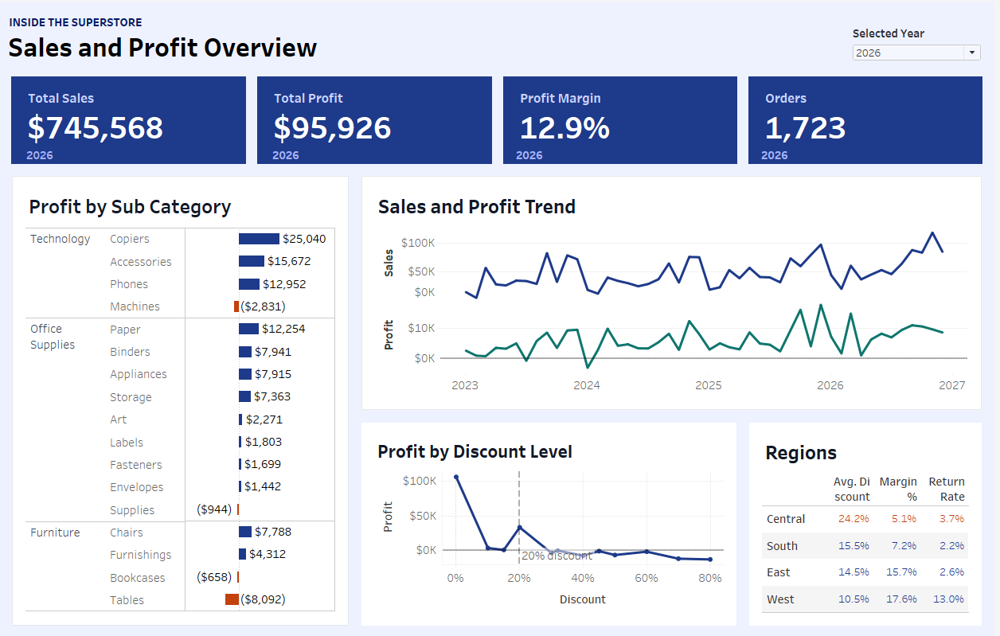

# Inside the Superstore

**A sales and profit analysis of the Superstore dataset using MySQL and Tableau**



🔗 **[View the interactive dashboard on Tableau Public](ADD-YOUR-TABLEAU-PUBLIC-LINK-HERE)**

---

## Overview

Superstore's sales grew steadily from 2023 to 2026, but sales alone do not show whether the business is healthy. This project looks beyond revenue to find which products, discounts, regions, and customers add to profit and which ones reduce it. The analysis was done entirely in MySQL, and the results are presented in a one-page Tableau dashboard.

## Key Questions

| # | Question |
|---|---|
| 1 | How have sales and profit changed from 2023 to 2026? |
| 2 | Which categories and sub-categories make or lose money? |
| 3 | How do discounts affect profit, and at what level do orders start losing money? |
| 4 | Which regions are underperforming, and do discounts or returns explain it? |
| 5 | Which customers bring in the most profit? |
| 6 | Which products should Superstore protect, fix, grow, or review? |
| 7 | How much profit was lost on orders discounted above 20%? |

## Tools

| Tool | Used for |
|---|---|
| MySQL 8.0 | Loading, exploring, cleaning, and analyzing the data |
| Tableau Public | Building the interactive dashboard |
| Excel | Converting the original file into CSVs for import |

## Dataset

The project uses Tableau's **Sample Superstore** dataset, which contains three sheets.

| Sheet | Contents | Rows |
|---|---|---|
| Orders | One row per product in an order, with dates, customer, location, product, sales, quantity, discount, and profit | 10,194 |
| Returns | Orders that were returned | 296 |
| People | The regional manager for each region | 4 |

The data covers **January 2023 to December 2026**, with 5,111 orders, 804 customers, 1,862 products, and 17 sub-categories across the United States and Canada.

## Process

**1. Setup.** Created the database and tables in MySQL and loaded the three CSV files. The order and ship dates were stored as month/day/year text, so they were converted to proper dates during the load with `STR_TO_DATE`.

**2. Exploration and quality checks.** Checked row counts, date ranges, missing values, number ranges, and category values, then tested for duplicates, impossible dates, and inconsistent IDs. The checks found four issues.

| Issue found | Decision |
|---|---|
| 2 duplicate rows | Removed the extra copies |
| 449 US postal codes missing their leading zero | Restored the zero with `LPAD` |
| 32 product IDs shared by two different products | Kept both, and identified products by ID and name together |
| 200 Canadian rows grouped into US regions | Kept as is and noted as a limitation |

**3. Cleaning.** Built a view called `orders_clean` instead of changing the raw table, so the original data stays untouched. The view removes duplicates, fixes postal codes, joins the Returns and People sheets, and adds columns for profit margin, discount band, shipping days, order year, and returned status.

**4. Analysis.** Answered each question with SQL, using CTEs, joins, `CASE` statements, and window functions such as `LAG`, `NTILE`, and `ROW_NUMBER`. Each result was exported as a CSV in the `results` folder.

**5. Dashboard.** Built a one-page Tableau dashboard with a year selector that updates every chart.

## Key Findings

**1. Sales and profit over time.** From 2023 to 2026, sales grew by 51%, orders by 73%, and profit by 86%. However, 2026 was the only year where profit grew more slowly than sales, and the margin dropped from 13.5% to 12.9%. September, November, and December were the strongest months every year.

**2. Categories and sub-categories.** Technology and Office Supplies both earned margins of about 17%, while Furniture earned only 2.6%. Furniture made almost a third of the store's sales but only about 7% of its profit. Tables (−$17.8K), Bookcases (−$3.6K), and Supplies (−$1.2K) lost money overall.

**3. Discounts.** Sales with no discount had a margin of 29.6%, and 20% was the last discount level that was still profitable on average. Above 20%, most sales lost money, and above 40%, every sale did.

**4. Regions.** Central had the lowest margin (7.9%) and the deepest average discount (24.1%), while its return rate was similar to the East and the South. In Technology, where Central's discounts were in line with other regions, it had the highest margin of any region. The West performed best overall but had the highest return rate at 11.6%.

**5. Customers.** The top 20% of customers earned 81.5% of total profit, while the bottom 20% lost the store $71.5K.

**6. Products.** Copiers, Phones, Accessories, and Binders sell well at healthy margins. Chairs, Storage, Machines, and Tables sell well but at low or negative margins. Paper, Labels, and Envelopes keep more than 40% of each sale as profit but sell relatively little.

**7. Losses from deep discounts.** Sales discounted above 20% lost the store $136.0K, equal to almost half of the store's total profit, and accounted for 88.6% of all losses. Tables, Machines, and Bookcases were all profitable when discounted at 20% or less.

## Recommendations

**1. Limit discounts to a maximum of 20%.** Sales discounted above 20% caused 88.6% of all losses. Superstore should set 20% as the standard maximum discount, with deeper discounts requiring managerial approval, starting with Binders, Tables, and Machines, which accounted for about 73% of these losses.

**2. Pilot the discount limit in the Central region.** Central has the lowest margin and the deepest discounts, yet it achieves the highest Technology margin of any region when its discounts are controlled. Applying the limit in Central for one season first would show its effect while limiting the risk to a single region.

**3. Retain top customers through service benefits and high-margin add-ons.** The top 20% of customers generate 81.5% of profit. Rewarding them with benefits such as faster shipping or a dedicated account contact, instead of deeper discounts, would protect margins. Offering high-margin supplies such as paper, labels, and envelopes alongside large purchases would also raise the profit of each order.

## Dashboard

The dashboard tells the story on a single page.

- **Key numbers** show total sales, profit, profit margin, and orders for the selected year.
- **Profit by Sub-category** ranks every sub-category and highlights losses in orange.
- **Sales and Profit Trend** shows monthly sales and profit from 2023 up to the selected year.
- **Profit by Discount Level** shows where profit turns negative after the 20% mark.
- **Regions** compares each region's margin, average discount, and return rate, with the weakest region highlighted.

The **year selector** updates every chart, so viewers can compare any year from 2023 to 2026.

## Limitations

- Superstore is fictional sample data from Tableau, so the findings demonstrate analysis methods rather than real business results.
- The profit figures do not appear to subtract returned orders, so the effect of returns on profit could not be measured directly.
- The link between Central's discounts and its low margin is a strong pattern, not a proven cause.
- The 200 Canadian rows are grouped into US regions in the original data.
- Quote marks and commas were removed from product names in the Tableau export to prevent the CSV file from breaking.
- The findings above cover 2023 to 2026 as a whole, while the dashboard shows one selected year at a time, so some figures differ between the two.

## Repository Structure

```
inside-the-superstore/
├── README.md
├── sql/
│   ├── 01_setup.sql                    Database setup and data loading
│   └── 02_cleaning_and_analysis.sql    Exploration, cleaning, and analysis
├── data/                               Original dataset and cleaned export
├── results/                            Query results for each question (CSV)
└── dashboard/
    ├── Inside_the_Superstore.twbx      Tableau workbook
    └── dashboard_preview.png           Dashboard screenshot
```
